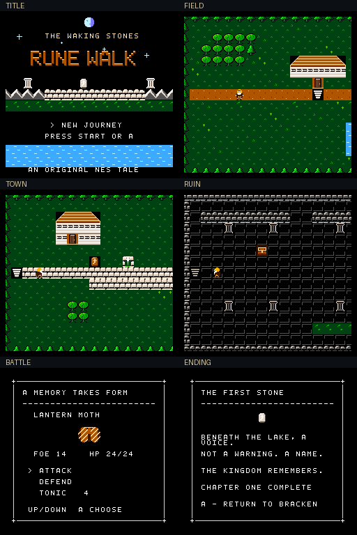

# Rune Walk — The Waking Stones

An original NTSC NES fantasy RPG opening chapter, built with cc65 and 6502
assembly. A copper-cloaked traveler arrives in Bracken as the old rune stones
begin to wake. Speak with the keeper, cross the river country, and confront the
three memories beneath Glassmere.

**[Download the playable ROM](https://github.com/DukeSkellington/RuneWalkRPG/raw/refs/heads/main/dist/rune-walk.nes)**

The checked-in `dist/rune-walk.nes` is the complete game image. On GitHub, open
that file and choose **Download raw file**. Open the downloaded `.nes` in Mesen
or copy it to an EverDrive N8 Pro SD card. No patching or additional assets needed.



## What's in this chapter

- Original beveled title lettering, moonlit title scene, stars and water shimmer.
- Four background palettes, detailed metatiles, copper-roof architecture, and a
  four-direction traveler with a standing pose and three walk poses per direction.
- An eight-screen, 2048×240 field, two river crossings, a settlement, and a ruin.
- Smooth horizontal scrolling, terrain and NPC collision, and bounded cameras.
- Keeper dialogue, a journal, one collectible chest, healing tonics and an objective.
- Three original guardians with attack, defend and tonic commands; health,
  experience, leveling, victory, recoverable defeat and a chapter conclusion.
- Original title and field compositions, ruin/battle arrangements, a one-shot
  victory fanfare, and sound effects on the actual NES APU.
- Vblank-safe tile/attribute streaming, palette fades and immediate battle cursors.

This is a playable introductory chapter, **not a completed commercial RPG**.
There is no battery save or Continue option. Reset starts a new journey.

## Controls and route

| Input | Exploration | Menus / battle |
| --- | --- | --- |
| D-pad | Move; one axis at a time | Up/down selects battle command |
| A | Speak / examine / enter nearby passage | Confirm / advance |
| B | — | Close dialogue/journal; quick defend in battle |
| Start | Journal, stats and objective | Close journal; begin on title |

The traveler moves one pixel per NTSC frame. Horizontal input has priority when
both axes are held; opposite directions on the same axis cancel. Collision uses
an inset feet box, allowing a small, intentional head overlap at obstacles.

1. Start a new journey; dismiss the introduction with A or B.
2. Walk a short distance east to Bracken's stair marker and press A.
3. Speak to the keeper standing above the plaza. The keeper restores health and
   supplies up to three tonics. Leave using A at the west stair.
4. Follow the main road east across **two bridges**. Examine the marked stair
   beneath the broken columns at Glassmere with A.
5. In the ruin, an old chest north of the entry contains one tonic. Continue east
   and examine the sleeping stone from the road below it.
6. Defeat its three guardians, using tonics when needed. Examine the stone once
   more to finish the chapter. Defeat returns you safely to Bracken.

Start opens the journal at any time during exploration. A uses a tonic there
when health is missing. The keeper offers a final conversation after completion.

## Build

Requirements: **cc65 V2.19 or newer**, GNU Make and Python 3. No graphics editor,
Node.js, emulator or downloaded assets are needed to produce the ROM. All artwork,
fonts, map layouts, compositions and conversion sources are in this repository.

```sh
make
make check
```

Output: `build/rune-walk.nes`. `make check` validates the iNES header, ROM size,
vectors, original asset schemas, objective accessibility and internal-RAM budget.
`make release` checks and copies the new ROM into `dist/`. `make clean` removes
only generated build files. Use `PYTHON=python` if your Python executable differs.

Install cc65, Make and Python with your platform package manager (Debian/Ubuntu,
Homebrew, or WSL). For the exact source toolchain used for these builds:

```sh
git clone --depth 1 --branch V2.19 https://github.com/cc65/cc65.git /tmp/cc65
git -C /tmp/cc65 rev-parse HEAD
# 555282497c3ecf8b313d87d5973093af19c35bd5
make -C /tmp/cc65 -j4
make CC65_HOME=/tmp/cc65 check
```

`CC65_HOME` points to a root containing `bin/` and `lib/`; otherwise `cl65` on
PATH is used. The existing cloud installation `/workspace/toolchains/cc65` is
recognized automatically. Reuse the existing checkout; a worktree is unnecessary.

## Test and capture

Optional execution tests need Node.js 22+ and the locked JSNES 2.1.0 dependency:

```sh
npm ci --prefix tests --ignore-scripts
make smoke
make audio
```

`make smoke` drives the **actual ROM with controller input**, through the complete
chapter and defeat recovery. It checks every displayed exploration tile and
attribute, both camera limits, movement speed, water collision, chest persistence,
defend, healing, leveling, ending and journal. Screenshots are written as
`build/*.ppm` and results as `build/test-results.json`.

`make audio` selects each score through its debug symbol, records the real APU
output to `build/music-*.wav`, checks non-silence and signal range, verifies music
loops and verifies that the fanfare ends. Audio selection is a test fixture, not
an extra in-game sound-test menu. `JSNES_ROOT` can select another installed copy.

For desktop and hardware checks, follow [the Mesen checklist](docs/MESEN_TESTING.md).
Mesen and original hardware have **not** been run in this cloud session.

## Listen

Actual ROM APU captures, encoded to MP3 for convenient listening:

- [Title — The Waking Stones](docs/evidence/music-title.mp3)
- [Overworld — The Old Road](docs/evidence/music-overworld.mp3)
- [Glassmere](docs/evidence/music-glassmere.mp3)
- [Battle](docs/evidence/music-battle.mp3)
- [Victory](docs/evidence/music-victory.mp3)

The editable scores are in `assets/music.py`. The title and field have 16-bar
forms with a returning motif, harmonic progression and contrasting middle section.
The ruin and battle tracks are arrangements of that material. Playback uses two
pulse voices, triangle bass and noise percussion. Sound effects temporarily own
the noise channel, then return it to the score. DPCM and expansion audio are unused.

## Cartridge and architecture

**NROM-256 / mapper 0**, 32 KiB PRG ROM, 8 KiB CHR ROM, vertical mirroring,
iNES 1.0 NTSC flag, 40,976-byte file, no trainer, battery or PRG RAM. This is a
standard cartridge configuration supported by the EverDrive N8 Pro. The chapter
fits comfortably without bank switching; MMC3 would add unnecessary complexity
at this scale. The target is an original North American NTSC NES, not PAL timing.

| Files | Responsibility |
| --- | --- |
| `src/startup.s`, `cfg/nrom.cfg` | Reset, RAM layout, vectors, bounded NMI transfers |
| `src/video.c` | Frame packet, scene loads, four palettes, fades and text wrapping |
| `src/world.c`, `tools/generate_world.py` | Field / Bracken / Glassmere, collision, packed attributes |
| `src/player.c`, `src/camera.c`, `src/input.c` | Traveler, animation, movement and camera ring |
| `src/game.c` | Mode dispatcher, interactions, objective, progression and recovery |
| `src/ui.c`, `src/combat.c` | Title, journal, dialogue, enemy art, turn resolution |
| `src/audio.s`, `assets/music.py` | NMI-safe APU playback and editable original scores |
| `assets/`, `tools/generate_*.py` | Editable pixel art, font, score and map converters |
| `tests/`, `tools/smoke.mjs` | Locked emulator dependency and actual-ROM tests |

The NMI never calls C or uses its zero-page temporaries. Main builds a complete
packet, publishes `ready` last, and waits for NMI ownership to end before changing
it. Audio runs every NMI, including while maps load with rendering disabled.
Terrain and palette attributes stream together into a 512-pixel nametable ring.
Map changes explicitly refill the ring at the new camera position.

See [technical limitations](docs/TECHNICAL_LIMITATIONS.md), [testing report](docs/TESTING_REPORT.md),
[art direction](docs/ART_DIRECTION.md), [development plan](docs/DEVELOPMENT_PLAN.md),
[quality review](QUALITY_REVIEW.md) and [next steps](NEXT_STEPS.md).
